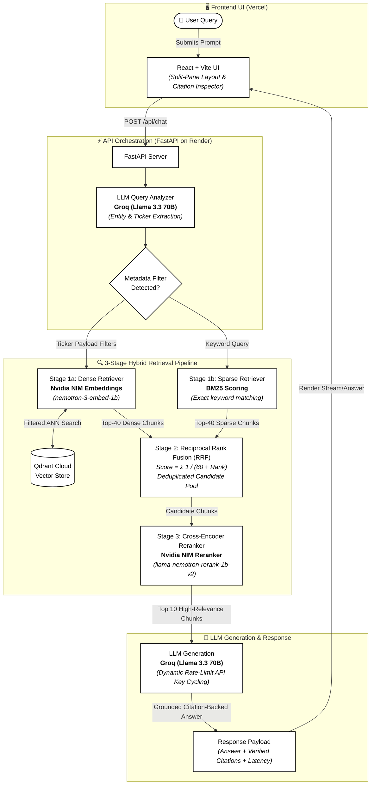
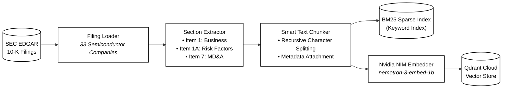

# SEC 10-K RAG Intelligence Engine

An **advanced Hybrid Retrieval-Augmented Generation (RAG) system** built over SEC 10-K filings for **33 U.S. semiconductor companies**. The system features a modern decoupled architecture: a **FastAPI backend** (deployed on Render) and a stunning **React/Vite frontend** (deployed on Vercel).

At its core, this engine implements an LLM-driven Query Analyzer for metadata pre-filtering, and a high-performance **3-stage hybrid retrieval pipeline** featuring Nvidia NIM embeddings, BM25 sparse retrieval, and cross-encoder reranking.

---

## 🚀 Live Demo

- **Frontend UI:** [https://sec-filings-rag-engine.vercel.app/](https://sec-filings-rag-engine.vercel.app/)
- **Backend API:** Hosted on Render (`https://sec-filings-rag-engine.onrender.com/api/health` to check status)

---

## 🏗️ Architecture Overview



### Data Ingestion & Indexing Pipeline



---

## 🛠️ Tech Stack

| Component                  | Technology                                   | Why This Choice                                                                                                     |
| -------------------------- | -------------------------------------------- | ------------------------------------------------------------------------------------------------------------------- |
| **Frontend UI**      | React + Vite                                 | Blazing fast local development, deployed globally on Vercel. Features a split-pane layout for inspecting citations. |
| **Backend API**      | FastAPI                                      | High-performance Python async framework, deployed on Render.                                                        |
| **LLM Inference**    | Groq (`openai/gpt-oss-120b`)               | Ultra-fast LPU inference enabling both Query Analysis and Generation to run in under ~2 seconds.                    |
| **Embeddings**       | Nvidia NIM (`nemotron-3-embed-1b`)         | Cloud-hosted state-of-the-art embedding model preventing local OOM crashes.                                         |
| **Reranker**         | Nvidia NIM (`llama-nemotron-rerank-1b-v2`) | Cloud-hosted cross-encoder for high-accuracy semantic ranking.                                                      |
| **Vector Store**     | Qdrant Cloud                                 | Stores vectors + metadata payload natively. Supports complex nested metadata pre-filtering.                         |
| **Sparse Retrieval** | `rank-bm25`                                | Industry-standard keyword ranking to complement dense retrieval.                                                    |
| **Data Validation**  | Pydantic v2                                  | Strict schema enforcement on config, filing documents, and chunk metadata.                                          |

---

## 🗄️ The Corpus

**33 semiconductor companies**, each with their most recent 10-K annual filing (2025–2026 fiscal years), sourced directly from SEC EDGAR.

Three specific critical sections are extracted and indexed per company:

- `business` (Item 1): Company overview, products, competitive landscape.
- `risk_factors` (Item 1A): All disclosed risks (supply chain, geopolitical, financial).
- `management_discussion` (Item 7): MD&A on financial condition and results.

**Companies included:**
ADI, ALAB, ALGM, AMAT, AMBA, AVGO, CDNS, COHR, CRDO, DIOD, ENTG, KLAC, LRCX, LSCC, MCHP, MKSI, MPWR, MRVL, MU, MXL, NVDA, NXPI, ON, ONTO, POWI, QCOM, RMBS, SITM, SLAB, SNPS, TER, TXN, WOLF.

---

## 💻 Local Development Setup

### 1. Environment Variables

Copy `.env.example` to `.env` in the root directory and fill in your API keys. You will need:

- `GROQ_API_KEY` (comma-separated if using multiple for rate limits)
- `NVIDIA_API_KEY`
- `QDRANT_URL` and `QDRANT_API_KEY`

### 2. Backend (FastAPI)

```bash
# Create a virtual environment
python -m venv venv
source venv/bin/activate  # On Windows use `venv\Scripts\activate`

# Install requirements
pip install -r requirements.txt

# Start the API server
uvicorn api.main:app --host 0.0.0.0 --port 8000 --reload
```

### 3. Frontend (React/Vite)

```bash
# Open a new terminal
cd frontend

# Install Node dependencies
npm install

# Start the Vite development server
npm run dev
```

### 4. Running the Indexer (First Time Only)

If your Qdrant cloud is empty, you'll need to run the data ingestion and vector embedding script:

```bash
python -m scripts.build_index
```

---

## 🚀 Deployment Guide

### Deploying the Backend (Render)

1. Connect your GitHub repository to Render as a **Web Service**.
2. **Build Command:** `pip install -r requirements.txt`
3. **Start Command:** `uvicorn api.main:app --host 0.0.0.0 --port $PORT`
4. Add your Environment Variables (`GROQ_API_KEY`, `NVIDIA_API_KEY`, `QDRANT_URL`, `QDRANT_API_KEY`).
   *Note: The `render.yaml` file is included in this repository to automate this setup.*

### Deploying the Frontend (Vercel)

1. Import the repository in Vercel.
2. Set the **Root Directory** to `frontend`.
3. Select **Vite** as the Framework Preset.
4. Set the `VITE_API_URL` environment variable if needed, or rely on the `vercel.json` rewrite rules to automatically proxy `/api` requests to your Render backend.

---

## 🧠 Key Differentiators vs. "Standard" RAG

- **Multi-Document Synthesis:** Standard RAG struggles to compare two documents. This system uses a Query Analyzer to extract specific tickers from the prompt (e.g. *"Compare NVDA and AVGO"*), executing targeted metadata pre-filtering across Qdrant before vector search even begins.
- **RRF + Reranker Precision:** Fusing Sparse (BM25) and Dense (Nvidia Embeddings) retrieval ensures we catch both exact keywords and semantic meaning. Feeding the top 30-40 results into a Cross-Encoder Reranker guarantees only the absolute highest-fidelity context makes it into the prompt.
- **Stateless Cloud Architecture:** Moving embeddings and reranking to the Nvidia NIM cloud APIs eliminated local OOM (Out-of-Memory) crashes on small Render instances, making the API incredibly lightweight.
- **Rate Limit Cycling:** The Groq API is famously fast but has strict free-tier rate limits. This system automatically rotates through an array of API keys dynamically on HTTP 429 errors to guarantee uptime.
